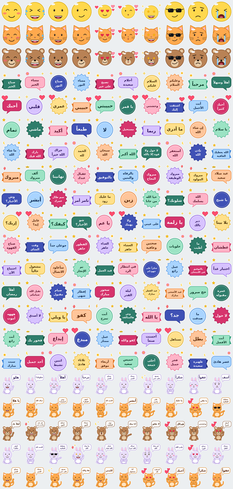

# ملصقات عربية — تطبيق ملصقات واتساب 🟢

تطبيق أندرويد يحتوي **630 ملصقاً أصلياً** في **21 حزمة**، مرسومة بالكامل بالكود (لا توجد أي صورة منقولة من مصدر آخر)،
مع إعدادات **GitHub Actions** جاهزة لبناء ملف APK تلقائياً.



## الحزم

| الحزمة | المحتوى | العدد |
|---|---|---|
| وجوه مرحة | 30 تعبيراً بوجه أصفر | 30 |
| قطط المزاج | نفس التعابير بشخصية قطة | 30 |
| دببة المشاعر | نفس التعابير بشخصية دب | 30 |
| تحيات وصباحيات | عبارات تحية ومناسبات | 30 |
| حب ومشاعر | عبارات حب ومودة | 30 |
| ردود سريعة | تمام، ماشي، أكيد... | 30 |
| دعاء وبركة | عبارات دعاء وبركة | 30 |
| مناسبات ومواقف | مبروك، شكراً، آسف... | 30 |
| لهجة خليجية | أبشر، زين، سم طال عمرك... | 30 |
| لهجات شامية ومصرية | إزيك، كيفك، ولا يهمك... | 30 |
| يوميات وأكل | قهوة، فطور، سفر، طقس... | 30 |
| دراسة وعمل | اجتماع، تم الإنجاز، بالتوفيق... | 30 |
| مناسبات إسلامية | رمضان، عيد، حج، دعاء... | 30 |
| مواقف طريفة | هههه أموت، لا أصدق، هذا أنا... | 30 |
| مديح وتشجيع | أنت رائع، فخور بك، استمر... | 30 |
| أيام وأوقات | أيام الأسبوع والفصول والأوقات | 30 |
| أرنوب يتكلم | شخصية أرنب كرتونية تقول: هلو، شلونك؟، أحبك... | 30 |
| ميمو يتكلم | شخصية قط كرتونية تقول: يا هلا، أبشر، تسلم... | 30 |
| دبدوب يتكلم | شخصية دب كرتونية تقول: أهلاً بك، فداك، أبي عسل... | 30 |
| أرنوب يتكلم 2 | عبارات إضافية للأرنب | 30 |
| ميمو يتكلم 2 | عبارات إضافية للقط | 30 |

## البناء على GitHub (الأسهل)

1. أنشئ مستودعاً جديداً على GitHub وارفع محتويات هذا المجلد إليه (فرع `main`).
2. افتح تبويب **Actions** — سيعمل workflow باسم **Build APK** تلقائياً عند كل `push`.
3. بعد نجاحه افتح التشغيل واحمّل الملف من **Artifacts ← ArabicStickers-debug-apk**، ثم ثبّته على هاتفك.
   (نسخة debug موقّعة تلقائياً بمفتاح التطوير وقابلة للتثبيت مباشرة.)

### إصدار موقّع (Release APK + AAB)

1. أنشئ مفتاح توقيع (مرة واحدة):
   ```bash
   keytool -genkeypair -v -keystore release.jks -alias stickers -keyalg RSA -keysize 2048 -validity 10000
   base64 -w0 release.jks     # انسخ الناتج
   ```
2. في المستودع: **Settings ← Secrets and variables ← Actions** وأضف:
   `KEYSTORE_BASE64` و `KEYSTORE_PASSWORD` و `KEY_ALIAS` و `KEY_PASSWORD`.
3. أنشئ وسماً وادفعه:
   ```bash
   git tag v1.0 && git push origin v1.0
   ```
   سيبني workflow **Release** ملفَي APK و AAB وينشرهما في صفحة **Releases** (أو شغّله يدوياً من Actions).
   بدون الأسرار سيُبنى الإصدار غير موقّع.

> احفظ ملف `release.jks` وكلمات المرور في مكان آمن ولا ترفعه إلى المستودع (مُستثنى في `.gitignore`).

## قبل النشر

- غيّر `applicationId` و `namespace` في `app/build.gradle` (وغيّر اسم الحزمة في مجلد `java/` إن رغبت).
- غيّر اسم الناشر في `tools/generate_stickers.py` (`PUBLISHER`) ثم أعد التوليد.
- أضف إلى `contents.json` رابط سياسة الخصوصية والبريد إن كنت ستنشر على Google Play.

## تعديل الملصقات أو إضافة غيرها

كل الملصقات تُولَّد بالسكربت `tools/generate_stickers.py`:

```bash
pip install pillow          # يلزم دعم libraqm لعرض العربية
python tools/generate_stickers.py
```

- لإضافة عبارة: أضفها إلى قائمة `TEXT_PACKS` (الحزمة الواحدة بحد أقصى 30 ملصقاً).
- السكربت يعيد كتابة `app/src/main/assets` و `contents.json` وأيقونات التطبيق ومعاينة README.
- مواصفات واتساب مطبّقة: WebP بحجم 512×512 وأقل من 100KB، وأيقونة الحزمة PNG بحجم 96×96 وأقل من 50KB،
  ومن 3 إلى 30 ملصقاً لكل حزمة، ورمز تعبيري واحد إلى ثلاثة لكل ملصق.

## البناء محلياً

افتح المشروع في Android Studio (Koala أو أحدث، JDK 17) وشغّل `app`، أو من الطرفية بعد تثبيت Gradle 8.7:

```bash
gradle assembleDebug     # الناتج: app/build/outputs/apk/debug/
```

## كيف يعمل

`StickerContentProvider` يقدّم بيانات الحزم من `assets/contents.json` وملفات الصور لواتساب،
وزر «إضافة إلى واتساب» يرسل الإجراء `com.whatsapp.intent.action.ENABLE_STICKER_PACK`
(ويدعم واتساب العادي و WhatsApp Business). التطبيق لا يستخدم أي مكتبات خارجية ولا يطلب أي صلاحيات.

## حقوق الملكية

الملصقات أُنشئت بالكامل بواسطة السكربت (أشكال هندسية ونصوص عربية) دون أي مواد من جهات أخرى.
الكود تحت رخصة MIT (انظر `LICENSE`). خط DejaVu المرفق في `tools/fonts` يُستخدم لتوليد الصور فقط
وهو مرخّص للتوزيع الحر، ولا يدخل في ملف APK.
